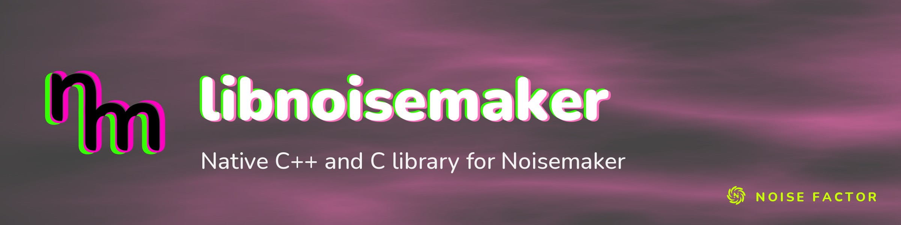

<!-- repo-hero -->
<a href="https://noisemaker.app/"></a>

<sub>Open source from <a href="https://noisefactor.io">Noise Factor</a> &middot; <a href="https://github.com/noisefactorllc">more projects</a></sub>

# libnoisemaker

> Run **Noisemaker** programs on the GPU from **C++** and **C**.

This library is under construction. Nothing here is ready to use yet.

## What is this?

**Noisemaker** is a procedural visual engine. You write short text programs, chains of effects, and
it renders live, animated GPU textures:

```
search synth, filter
noise(scaleX: 60).bloom().write(o0)
render(o0)
```

That language is Noisemaker's **DSL**. The original engine runs in the browser at
[noisedeck.app](https://noisedeck.app).

**libnoisemaker** is a native C++ library, with a C API, that runs [Noisemaker](https://noisemaker.app)
programs on the GPU through [Dawn](https://dawn.googlesource.com/dawn). It tracks Noisemaker 1.0.288,
the version locked in `parity/reference.json`.

## Requirements

CMake 3.22 or later, a C++20 compiler, Python 3.12 or later, Node.js 26, Git and Ninja (or Visual
Studio 2026 on Windows).

## Building

```sh
python3 tools/fetch_dawn.py
cmake -S . -B build -G Ninja -DCMAKE_BUILD_TYPE=Release
cmake --build build
ctest --test-dir build --output-on-failure
```

To build only the GPU-free compiler core and host helpers, with no Dawn tree, configure with
`-DNM_BUILD_GPU=OFF` and skip `fetch_dawn.py`.

To build Dawn once and reuse it in any number of build directories, install it with
`tools/build_dawn.py` and configure with `NM_DAWN_PREBUILT_DIR`. CI caches one such install per
platform.

```sh
python3 tools/fetch_dawn.py
python3 tools/build_dawn.py --generator Ninja --prefix .cache/dawn-install/local
cmake -S . -B build -G Ninja -DCMAKE_BUILD_TYPE=Release -DNM_DAWN_PREBUILT_DIR=$PWD/.cache/dawn-install/local
```

## Using it from CMake

`-DNM_BUILD_SHARED=ON` builds `noisemaker_core` as a shared library that exports only the C API
(`include/noisemaker/core.h`) and the C++ API (`core.hpp`, `value.hpp`). Install it and find it as a
package:

```sh
cmake -S . -B build-shared -G Ninja -DCMAKE_BUILD_TYPE=Release -DNM_BUILD_GPU=OFF -DNM_BUILD_SHARED=ON
cmake --build build-shared
cmake --install build-shared --prefix /path/to/prefix
```

```cmake
find_package(noisemaker CONFIG REQUIRED COMPONENTS core)
target_link_libraries(app PRIVATE noisemaker::core)
```

The installed headers need C++17. The C++ API passes standard-library types across the library
boundary, so a C++ consumer must use the same compiler and standard library as the build.
`share/noisemaker/TOOLCHAIN` names them, and `share/noisemaker/ENGINE` names the Noisemaker release
the embedded catalog comes from.

Releases are published by the `Release` workflow: one archive per platform (Linux x64 and arm64,
macOS universal for 13.0 and later, Windows x64 and arm64) and a `SHA256SUMS` file.

## Testing

`scripts/test` builds the GPU-free tree, runs its unit tests and the tool tests, then runs every
parity gate (`scripts/gates`) against the reference engine at the commit locked in
`parity/reference.json`. It needs network access to clone the reference and fetch the catalog.

## Contributing

Contributions follow the Noise Factor
[contributing policy](https://github.com/noisefactorllc/.github/blob/main/CONTRIBUTING.md) and
[Code of Conduct](https://github.com/noisefactorllc/.github/blob/main/CODE_OF_CONDUCT.md).

## Repo layout

```
include/noisemaker/   public C API headers
src/core/             GPU-free core: DSL lexer, parser and compiler, render graph, effect catalog, editing
src/host/             host inputs: audio and MIDI state, OBJ parsing, stroke raster, worm tracer
src/gpu/              Dawn device and the backend's device on it; wgsl/ and backend/, the reference
                      WebGPU backend and pipeline over a device interface, with their WGSL analysis
                      and uniform packing (gated with no GPU)
src/capi/             C API implementation
tests/                C API, core, GPU, host and tool tests
parity/               reference lock, corpus and checks against the reference engine
scripts/              test, gate and reference entry points
tools/                Dawn fetch and build, catalog tools, reference oracles, dump tools and nm-render
cmake/, third_party/  Dawn build integration and its lock
```

## License

MIT (see [LICENSE](LICENSE)). Dawn and its dependencies carry their own licenses (BSD-3-Clause,
Apache-2.0, MIT). Use of the Noisemaker and Noise Factor names in derivative products is subject to
the [Trademark Policy](TRADEMARK.md).

Copyright © 2026 Noise Factor LLC
